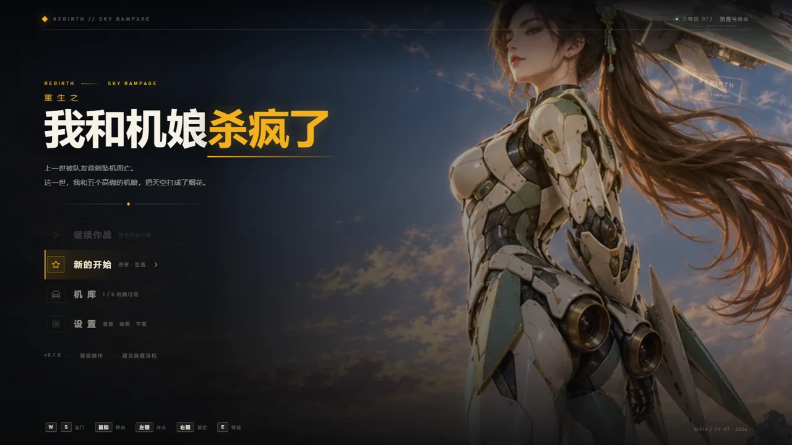
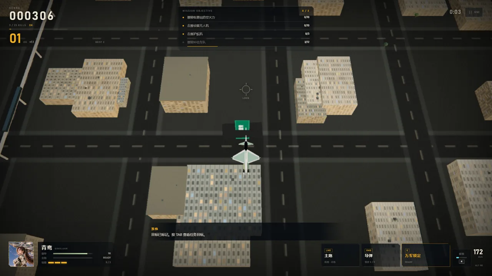
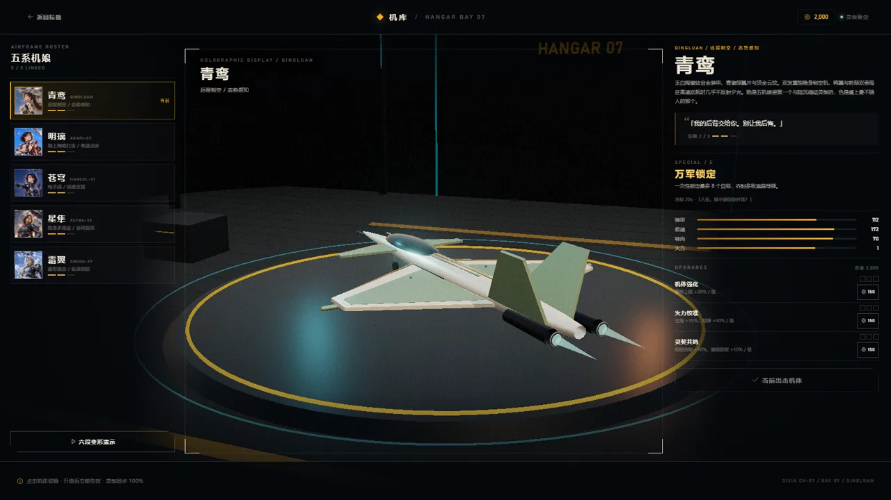
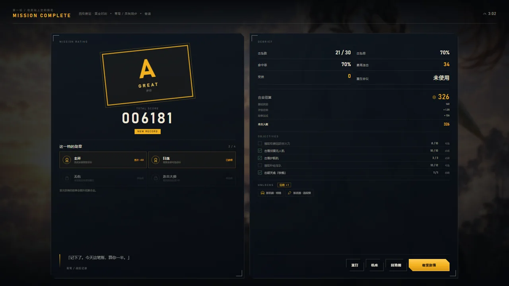
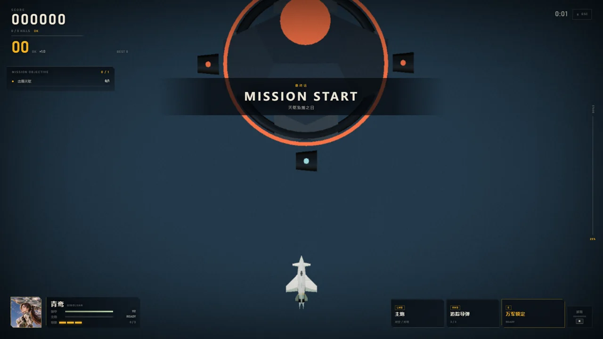
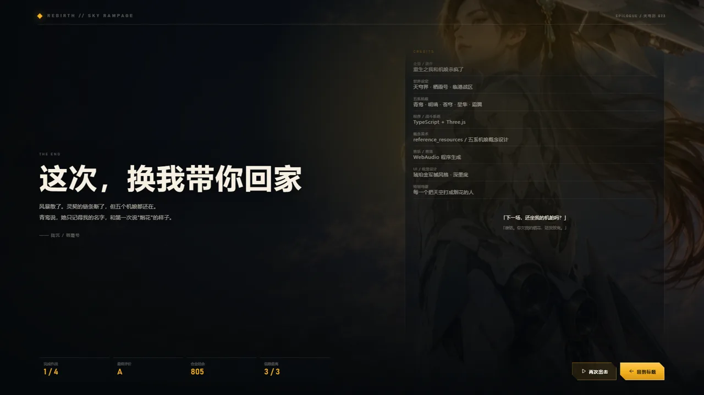
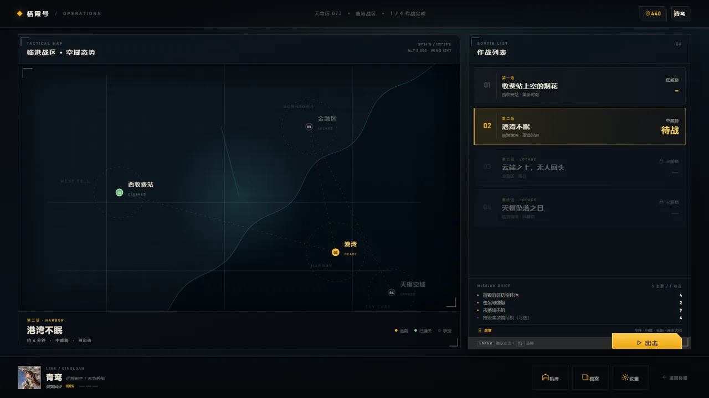

# 重生之我和机娘杀疯了

> 上一世被队友背刺坠机而亡的我，重生到机娘主宰的天空，和五个高傲的「机娘」把敌人杀成了烟花。

一款可直接在浏览器里玩的 **3D 俯视角空战街机小游戏**。你驾驶由机娘变形而成的战机，在临港市上空完成 4 场作战，靠连击、评分、勋章和合金解锁五系机娘与武器，并走完「背刺—重生—并肩—终战」的主线。



## 快速开始

```bash
npm install
npm run dev
```

打开终端里显示的地址（默认 <http://127.0.0.1:5173/>），建议 Chrome / Edge，全屏体验更佳。

生产构建：

```bash
npm run build
npm run preview
```

## 操作

| 输入 | 行为 |
|---|---|
| 鼠标移动 / 方向键 | 转向、瞄准 |
| W / S | 油门 |
| Shift | 加力 |
| 左键 | 主炮（有过热） |
| 右键按住 | 锁定锥内目标，松开齐射导弹 |
| E | 机娘特技 |
| R | 解限（需要满槽） |
| Esc | 暂停 |
| 空格 / 回车 | 剧情推进 |

> 首次点击页面才会解锁 WebAudio；没有声音时先点一下界面。

## 内容

- **4 场作战**：西收费站 → 港湾 → 金融区 → 天枢要塞。四种时段光照（黄昏、蓝调、落日、风暴）。
- **5 名机娘**：青鸾、明璃、苍穹、星隼、霜翼。各自拥有独立的机体外形、配色、数值和特技；通关解锁。
- **机娘就是战机**：人形/战机六阶段变形概念图被做成出击过场；机库里有 3D 战机转台和变形演示。
- **战斗系统**：主炮过热、导弹锁定、机娘特技、解限、连击、评分、S/A/B/C 评级、四类勋章、重生协议。
- **成长**：合金、三项升级、武器/角色解锁、信赖度、本地存档。
- **剧情**：序章 + 4 话 + 尾声，约 100 句台词；对话框、自动播放、记录、跳过。
- **界面**：标题、母舰作战地图、简报、机库、档案、剧情、关卡 HUD、结算、设置、结局制作名单。
- **程序化内容**：城市、地标、战机、敌机、Boss、特效、音乐音效全部由代码生成；仅角色立绘/概念图来自 `reference_resources`。

| 作战 | 机库 | 结算 |
|---|---|---|
|  |  |  |

| Boss | 结局 | 母舰 |
|---|---|---|
|  |  |  |

## 技术

- Vite 8 + TypeScript 7（strict）+ Three.js 0.186
- 原生 DOM/CSS 做 HUD 与界面，Three.js 负责 3D；不引入前端框架
- 程序化城市：实例化楼体/树木/车辆、收费站、港湾吊机、金融区塔楼、单轨、广告牌
- 程序化战机：按五套参数生成机身/机翼/鸭翼/垂尾/发动机/涂装
- 后处理：Bloom、暗角、颗粒、速度色差、受击红边
- WebAudio 合成音效与音乐；localStorage 双存档（进度/设置分离）
- 测试：Vitest 单元测试 + Puppeteer 无头 Chrome 冒烟与截图

## 目录

```
src/
  app/         屏幕状态机、存档、各界面
  core/        循环、输入、音频、素材、存储
  data/        机娘/任务/剧情/数值/资产清单
  game/        玩家、敌人、Boss、特效、计分、任务导演
  render/      渲染器、环境、城市、战机、程序化几何
  ui/          HUD、DOM 工具
  styles/      各界面样式
public/assets/ 由概念图生成的 WebP（脚本可重建）
scripts/       素材管线、截图、QA 冒烟
tests/         计分与存档单元测试
docs/          设计文档、QA、截图
```

## 素材与版权

- 五名机娘的立绘、三视图、六阶段变形图来自用户提供的 `reference_resources` 概念设计；本项目只做裁切、WebP 转码和界面排版，不在仓库中提交原始大图/视频。
- 参考视频仅用于研究玩法、镜头与 HUD 布局，未提取任何画面素材；游戏内广告牌、品牌、任务与台词均为原创虚构内容。
- 未使用真实国旗、军队身份或现役军机标识。
- 音乐、音效由 WebAudio 实时合成；字体使用系统字体。

## 脚本

```bash
npm run prepare-art     # 从 reference_resources 重新生成 WebP 与资产清单
npm run shots           # 无头 Chrome 截取所有界面到 artifacts/screens
npm run test            # Vitest
npm run typecheck
node scripts/qa-flow.mjs      # 新游戏→序章→母舰→关卡→结算→战后
node scripts/qa-boss.mjs      # Boss 三阶段 + 结局
node scripts/qa-girls.mjs     # 五机娘模型/特技/两张地图
node scripts/qa-combat.mjs    # 开火推进、强制通关、结算存档
node scripts/qa-combat-extra.mjs # 锁定、解限、暂停、重生、失败结算
node scripts/qa-mouse.mjs     # 真实鼠标点击/右键输入穿透验证
```

调试入口：`?test=1` 会禁用 CSS 动画并暴露 `window.__REBIRTH__`（`state()`、`startMission()`、`winMission()`、`damageBoss()`、`advance(seconds, fire)` 等）。URL 参数 `?screen=title|hub|hangar|briefing|dialogue|mission|results|settings|codex|ending` 可直接进入指定界面。

## 已知限制

- 美术是风格化低模 + 概念图 UI，不追求参考视频的写实精度。
- 未做 3D 机娘人形建模；角色演出依赖立绘、cut-in 和六阶段变形图。
- 无配音、无移动端触屏、无联机/排行榜；首版为单人离线。
- 关卡目标与数值仍在首轮平衡，建议先玩普通难度。
- 极端低配或关闭硬件加速时性能会下降；设置里可切低画质。

## 版本

`0.1.0` — 可玩垂直切片：完整流程、五机娘、三关 + Boss、剧情与结局、存档与养成。
