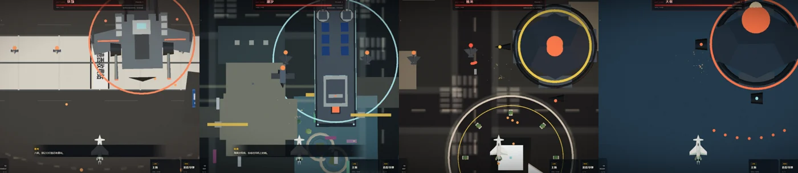
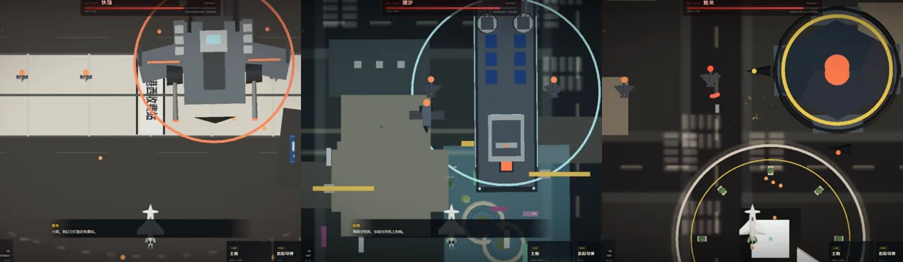
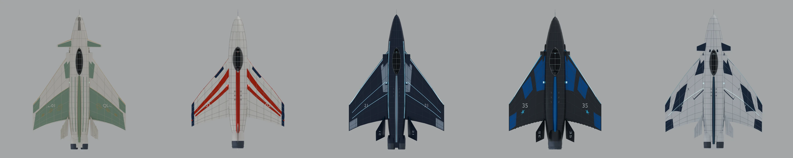
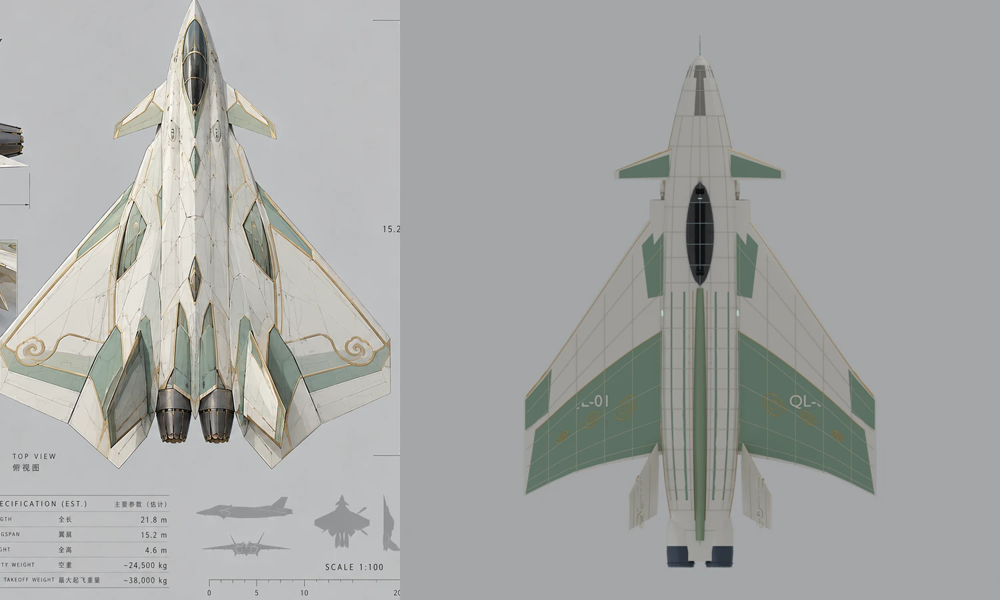
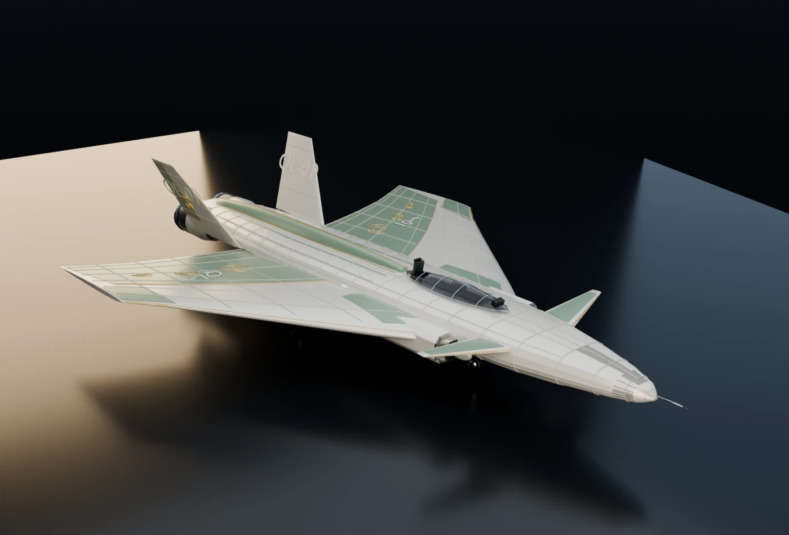

# 重生之我和机娘杀疯了

> 上一世被队友背刺坠机而亡的我，重生到机娘主宰的天空，和五个高傲的「机娘」把敌人杀成了烟花。

一款可直接在浏览器里玩的 **3D 竖版卷轴弹幕空战小游戏**，玩法参考《雷电》：战机固定在屏幕下方八方向移动，屏幕持续向上滚动，敌机编队从上方压下来，靠走位、弹幕判断、连击和炸弹通关。你驾驶由机娘变形而成的战机，在临港市上空完成 4 场作战，靠评分、勋章和合金解锁五系机娘与武器，并走完「背刺—重生—并肩—终战」的主线。


## 快速开始

```bash
npm install
npm run dev
```

打开终端里显示的地址（默认 <http://127.0.0.1:5173/>），建议 Chrome / Edge，全屏体验更佳。

**在线试玩（GitHub Pages / CDN）：** <https://freefoxcm.github.io/rebirth-mecha-girl/>

生产构建：

```bash
npm run build
npm run preview
```

## 操作

| 输入 | 行为 |
|---|---|
| WASD / 方向键 | 八方向移动（卷轴自动前进） |
| Shift | 低速精瞄，显示机身判定点 |
| 左键 / 空格 | 主炮连续射击（有过热） |
| 右键 | 追踪导弹（自动锁定最近空中目标） |
| E | 机娘特技（弹幕清场/爆发） |
| R | 解限（满槽后 8 秒火力全开） |
| Esc | 暂停 |
| 空格 / 回车 | 剧情推进 |

> 首次点击页面才会解锁 WebAudio；没有声音时先点一下界面。

## 内容

- **4 场竖版卷轴作战**：西收费站 → 港湾 → 金融区 → 天枢要塞。四种时段光照（黄昏、蓝调、落日、风暴），城市/港湾在正交俯视下持续向下滚动；**每关都有独立关底 Boss**。
- **5 名机娘**：青鸾、明璃、苍穹、星隼、霜翼。各自拥有独立的机体外形、配色、数值和特技；通关解锁。
- **机娘就是战机**：五台战机以 Blender 源文件重建，机库有展示级 3D 高模和变形演示；六阶段概念图被做成出击过场。
- **弹幕战斗**：主炮过热、追踪导弹、机娘特技、解限、连击、评分、S/A/B/C 评级、四类勋章、重生协议；敌机编队、地面炮塔、王牌与三阶段 Boss。
- **成长**：合金、三项升级、武器/角色解锁、信赖度、本地存档。
- **剧情**：序章 + 4 话 + 尾声，约 100 句台词；对话框、自动播放、记录、跳过。
- **界面**：标题、母舰作战地图、简报、机库、档案、剧情、关卡 HUD、结算、设置、结局制作名单。
- **程序化内容**：城市、地标、战机、敌机、Boss、特效、音乐音效全部由代码生成；仅角色立绘/概念图来自 `reference_resources`。

| 作战 | 机库 | 结算 |
|---|---|---|
|  |  |  |

| Boss | 结局 | 母舰 |
|---|---|---|
|  |  |  |

## 关底 Boss

| 关卡 | 关底 | 类型/机制 |
|---|---|---|
| M1 收费站 | **铁颚** | 重装指挥炮艇：双联重炮、侧舷导弹舱、无人机增援 |
| M2 港湾 | **潮汐** | 导弹母舰：舰炮扇射、追踪鱼雷、近防弹幕 |
| M3 金融区 | **烛龙** | 空中堡垒：环形弹幕、垂直光束、区域增援 |
| M4 天枢要塞 | **天枢** | 三阶段：护盾发生器 → 核心暴露 → 夜枭/要塞合体 |

每关的 Boss 在编队清空后进入，卷轴停在对应地标（收费站/港湾/金融区/海湾）；M1–M3 是独立模型与弹幕风格，M4 保留四台护盾发生器。



## 场景细化

- 街区加入**斑马线/停止线**，建筑屋顶加入**停机坪 H、天线、水箱、光伏板、退台冠部**。
- 港湾增加**仓库、卷帘门、屋顶通风、系缆桩、码头灯柱**；金融区增加**空中连廊、单轨站台、广场花坛**；收费站增加**车道信号灯和广场护栏**。
- 关底战场落在对应地标：M1 收费站雨棚、M2 港区仓库/集装箱、M3 金融区广场与塔楼。



## 战机外形：Blender 资产管理

五台机的外形不再由运行时参数化拼装，而是以 `reference_resources/<id>/02_战机三视图.png` 为基准，在 Blender 5.2 里用 Python 脚本生成可编辑源文件，再导出为游戏 GLB：

- **单块折线机翼**：按设计图俯视轮廓取 7 个平面控制点，包含根弦、转折、外翼后掠和斜切翼尖；鸭翼 / LEVCON 为独立翼面。
- **机身**：带折线 chine 的放样截面，双发/单发机尾分别处理；座舱、DSI/方棱进气、花瓣喷口、起落架、面板线在 Blender 内完成。
- **两档 LOD**：机库展示级约 10–12 万三角面，任务级约 0.7–1 万三角面；Draco 压缩后每台展示级约 150–190 KB。
- **游戏接入**：启动预载任务低模；机库按需异步加载展示级模型并原地替换；加载失败自动回退到旧程序化模型；`?jets=procedural` 可强制回退。
- 机库左下 **设计对照** 仍可在展示 / 俯视 / 侧视 / 正视之间切换，用来对照设计稿轮廓。



| 概念 / 机库 | 展示级效果 |
|---|---|
|  |  |

> 实时 GLB 中暂不包含面板缝几何：细管在浏览器里会采样成虚线，已保留在 `.blend` 与 Cycles 渲染中。后续如需要游戏内面板线，会以烘焙贴图/法线方式补回。

## 打击感升级

- **爆炸**：核心闪光、低模火球、火/烟粒子、金属碎片、火星、冲击波环、炮口闪光；空中/地面/水面三套表面，Boss 死亡多波连环爆。
- **震动**：trauma 驱动的平滑多频相机位移 + roll + 正交 zoom；小敌、炮艇、Boss、受击、特技分级触发，暂停/结算归零。
- **音效**：分层爆炸（低频下潜+噪声+裂响+碎片）、立体声像、金属/护盾命中、引擎底噪、Boss 警报；全部由 WebAudio 合成。


## 技术

- Vite 8 + TypeScript 7（strict）+ Three.js 0.186
- 原生 DOM/CSS 做 HUD 与界面，Three.js 负责 3D；不引入前端框架
- 程序化城市：实例化楼体/树木/车辆、收费站、港湾吊机、金融区塔楼、单轨、广告牌
- 战机资产：Blender 5.2 Python 管线生成 `.blend` + `showcase/game` 两档 GLB（Draco）；机库高模异步加载、任务 LOD、程序化模型回退；支持俯视/侧视/正视设计对照。详见 [`docs/BLENDER.md`](docs/BLENDER.md)
- 表现层：分层爆炸池、碎片/火星/尾迹、trauma 相机震动、分层 WebAudio 爆炸与立体声像
- 后处理：Bloom、暗角、颗粒、速度色差、受击红边
- WebAudio 合成音效与音乐；localStorage 双存档（进度/设置分离）
- 测试：Vitest 单元测试 + Puppeteer 无头 Chrome 冒烟与截图

## 目录

```
src/
  app/         屏幕状态机、存档、各界面
  core/        循环、输入、音频、素材、存储
  data/        机娘/任务/剧情/数值/战机 manifest
  game/        玩家、敌人、Boss、特效、计分、任务导演
  render/      渲染器、环境、城市、GLB 机型加载/回退
  ui/          HUD、DOM 工具
  styles/      各界面样式
public/assets/
  girls/       由概念图生成的 WebP（脚本可重建）
  jets/        Blender 导出的 showcase/game GLB（Draco）
  draco/       构建时复制的 Draco 解码器（不入库）
art/blender/   Blender 建模库、jet specs、构建/渲染脚本、source/*.blend
scripts/       素材管线、Blender 构建/校验、截图、QA 冒烟
tests/         计分与存档单元测试
docs/          设计文档、QA、Blender 管线、截图
```

## 素材与版权

- 五名机娘的立绘、三视图、六阶段变形图来自用户提供的 `reference_resources` 概念设计；本项目只做裁切、WebP 转码和界面排版，不在仓库中提交原始大图/视频。
- 参考视频仅用于研究玩法、镜头与 HUD 布局，未提取任何画面素材；游戏内广告牌、品牌、任务与台词均为原创虚构内容。
- 未使用真实国旗、军队身份或现役军机标识。
- 音乐、音效由 WebAudio 实时合成；字体使用系统字体。

## 脚本

```bash
npm run prepare-art     # 从 reference_resources 重新生成 WebP 与资产清单
npm run setup:blender   # 下载/解压便携 Blender 5.2 到 .tools（已存在则跳过）
npm run art:jets        # 重新生成五台机的 .blend / GLB / src/data/jet-models.json
npm run art:render      # 渲染五台机的三视图与 3/4 效果图
npm run validate:jets   # 校验 GLB 结构、尺寸、三角面与体积预算
npm run qa:jets         # 机库/任务内战机模型冒烟与截图
npm run shots           # 无头 Chrome 截取所有界面到 artifacts/screens
npm run test            # Vitest
npm run typecheck
node scripts/qa-flow.mjs      # 新游戏→序章→母舰→关卡→结算→战后
node scripts/qa-boss.mjs      # M4 Boss 三阶段 + 结局
node scripts/qa-stage-bosses.mjs # M1–M4 关底刷新/阶段/截图
node scripts/qa-girls.mjs     # 五机娘特技/两张地图
node scripts/qa-jets.mjs      # 五机娘俯视外形 + draw call
node scripts/qa-jet-model.mjs # 五台机库 showcase 异步加载 + 任务 game LOD 冒烟
node scripts/qa-combat.mjs    # 开火推进、强制通关、结算存档
node scripts/qa-combat-extra.mjs # 特技、解限、暂停、重生、失败结算
node scripts/qa-mouse.mjs     # 真实鼠标左/右键输入穿透验证
node scripts/qa-fx.mjs        # 爆炸截图 + 相机震动衰减
node scripts/qa-audio.mjs     # WebAudio 解锁/分层爆炸/引擎循环
```

调试入口：`?test=1` 会禁用 CSS 动画并暴露 `window.__REBIRTH__`（`state()`、`startMission()`、`winMission()`、`damageBoss()`、`advance(seconds, fire)` 等）。URL 参数 `?screen=title|hub|hangar|briefing|dialogue|mission|results|settings|codex|ending` 可直接进入指定界面。

## 已知限制

- 美术是风格化低模 + 概念图 UI，不追求参考视频的写实精度。
- 未做 3D 机娘人形建模；角色演出依赖立绘、cut-in 和六阶段变形图。
- 无配音、无移动端触屏、无联机/排行榜；首版为单人离线。
- 首版没有关卡内火力道具掉落；成长放在机库/结算，后续可补 Raiden 式道具。
- 四关关底 Boss 已接入，但 M1–M3 的弹幕/机制仍是首轮版本（共用部分 Boss 骨架，模型/攻击风格不同）；专属机制与更复杂的弹幕可以继续深化。
- 五台机是 **Blender 设计图级重建**，不是 CAD/照片级：折线机翼、鸭翼/尾翼、进气、喷口、编号与配色已按三视图重建，但座舱内构、铆钉密度、曲面连续性、侧影厚度仍有提升空间。设计稿本身也有少量三视图不一致，冲突处以轮廓和游戏可读性优先。
- 实时 GLB 暂不含面板缝几何；设计图中的密集缝线只存在于 `.blend`/Cycles 渲染，后续可用烘焙贴图或法线贴图补回。
- 爆炸、震动、音效完成首轮分层；爆炸仍是风格化低模，真机听感需要你在浏览器里试听后再调音量/密度。
- 关卡目标与数值仍在首轮平衡，建议先玩普通难度。
- 极端低配或关闭硬件加速时性能会下降；设置里可切低画质。

## 版本

`0.2.0` — 五系机娘战机改为 Blender 资产管线（可编辑 `.blend` + showcase/game 双 LOD GLB、Draco、机库异步加载与程序化回退）；四关、四关关底 Boss、场景细节、分层爆炸/震动/音效、完整流程与养成保持不变。
